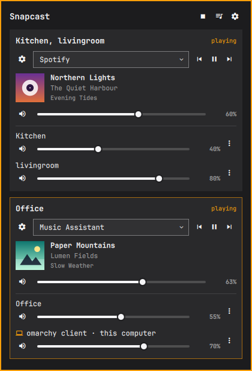
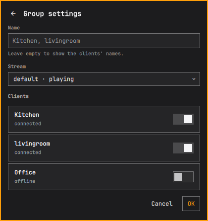
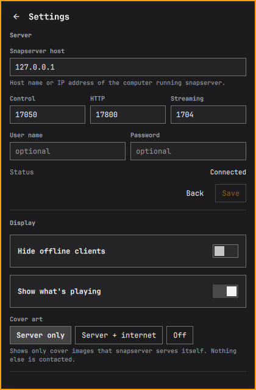

# Snapcast Control for Omarchy

A bar widget for the [Omarchy](https://omarchy.org) 4.5 shell that controls a
[Snapcast](https://github.com/snapcast/snapcast) multi-room audio server. It does what
[SnapWeb](https://github.com/snapcast/snapweb) does, from the bar:

- a card per group, each with stream selection, previous/play-pause/next, now playing (title,
  artist, album, cover art) and group volume/mute
- client rows with volume and mute; client details (name, latency, MAC/IP/host/OS/version), and
  deleting offline clients
- group settings: name, stream, which clients belong to the group, shuffle/repeat/seek
- streams: list, remove, and **add** streams (pipe/FIFO, TCP, file, ALSA, meta, librespot, AirPlay)
- **play on this computer**: runs `snapclient` and puts this computer on the server as a client
- scroll on the bar icon to change the volume; middle-click to start/stop local playback

It talks to snapserver with the [JSON-RPC Control API](https://github.com/snapcast/snapcast/blob/develop/doc/json_rpc_api/control.md)
over TCP (port 1705).

## Install

```bash
sudo pacman -S --needed deno                 # the plugin's connection helper runs on Deno
omarchy plugin add https://github.com/odaszek/omarchy-snapcast-ctrl.git --enable
omarchy pkg aur add snapcast                 # optional: only for "play on this computer"
```

Open the panel (click the speaker icon), press `s` or the cog, and enter your snapserver's host
name or IP address.

**Update:** `omarchy plugin update odach.snapcast-ctrl`, then `omarchy restart shell` (the shell
keeps the plugin's service loaded, so new code is picked up only after a restart).

**Uninstall:** `omarchy plugin remove odach.snapcast-ctrl`, then `omarchy restart shell` (this also
stops snapclient if local playback was on). The settings stay in the widget's entry in
`~/.config/omarchy/shell.json`, and the log and cover-art cache in
`~/.local/state/omarchy/snapcast-ctrl`; delete that folder too to remove everything, and the
server password, if you saved one, with `secret-tool clear service omarchy-snapcast-ctrl`.

**From a checkout (development):** `scripts/install.sh` copies the plugin into
`~/.config/omarchy/plugins/odach.snapcast-ctrl` and restarts the shell. Use one method or the
other: `omarchy plugin update` only updates a plugin installed with `omarchy plugin add`.

## Screenshots

| Groups, now playing, this computer | Group settings | Settings |
|---|---|---|
|  |  |  |

More in [docs/screenshots](docs/screenshots).

## Settings

Stored in the widget's entry in `~/.config/omarchy/shell.json` (edited from the panel's Settings
page; hand edits are picked up live):

| Key | Default | |
|---|---|---|
| `host` | `""` | snapserver host name or IP |
| `port` / `httpPort` / `streamPort` | 1705 / 1780 / 1704 | control (JSON-RPC), HTTP (cover art), streaming (snapclient) |
| `username` | `""` | only for servers with authentication; the password goes to the keyring |
| `hideOffline` | `false` | hide offline clients (and groups without online clients) |
| `showMetadata` | `true` | show now playing |
| `coverArt` | `"server"` | `server`: only snapserver's own images; `any`: any host (e.g. Spotify's CDN — they see what you play); `off` |
| `volumeStep` | 5 | percent per scroll step |
| `localPlayback` | `false` | run snapclient |
| `localPlayer` | `"pulse"` | `pulse` (PipeWire's Pulse server), `pipewire`, `alsa` |
| `localSoundcard` | `""` | from `snapclient --player <p> --list`; empty = default |
| `localLatency` | 0 | extra device latency in ms |
| `localHostId` | `""` | client id on the server; default `omarchy-<hostname>`. The client is shown as "<hostname> client" (set once while it has no name; rename it freely) |
| `popupWidth` / `popupMaxHeight` | 420 / 640 | panel size |

## Keyboard

In the panel: `←/→` volume of the target group, `↑/↓` scroll, `g` group settings, `t` streams,
`n` add stream, `s` settings, `p` play on this computer, `m` mute, `r` reconnect, `Esc` back/close.

## Files

- `~/.local/state/omarchy/snapcast-ctrl/logs/helper.log` — log
- `~/.local/state/omarchy/snapcast-ctrl/art/` — cover-art cache (≤ 64 images)
- keyring entry `service=omarchy-snapcast-ctrl` — server password, if any

## Security

The plugin treats everything the server sends as untrusted, renders it as plain text, never loads
remote images in the shell, and runs its helper with a minimal Deno permission set (network access
only to the configured server). Snapcast's control protocol itself is unauthenticated plaintext:
use it on a trusted network. Details: [docs/security.md](docs/security.md).

## Development

[docs/testing.md](docs/testing.md) (tests, mock server, SnapWeb parity checklist),
[docs/ipc.md](docs/ipc.md) (helper protocol), [docs/dependencies.md](docs/dependencies.md),
[docs/troubleshooting.md](docs/troubleshooting.md).

```bash
scripts/test.sh        # type check, lint, 70+ Deno tests, QML tests, qmllint, manifest validation
scripts/install.sh     # install into ~/.config/omarchy/plugins and restart the shell
```

MIT licensed.
